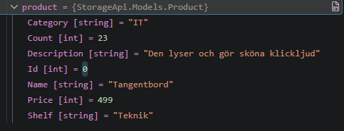
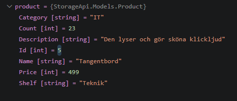
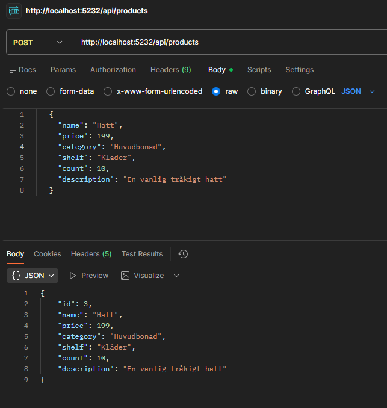

# Genomgång av min Web API-controller & EF Core-integration

Här är mina anteckningar och min genomgång av hur **ProductsController** och min **StorageApiContext** fungerar i projektet med stöttning med AI att få mina smått röriga förklaringar till snygg text.

---

## 1. Mina genererade metoder och endpoints

Efter scaffoldingen har jag fått följande metoder i min controller.

| Metod | HTTP | URL-rutt | Beskrivning |
| :--- | :--- | :--- | :--- |
| **GetProduct()** | GET | `/api/products` | Hämtar alla produkter från databasen. |
| **GetProduct(int id)** | GET | `/api/products/{id}` | Hämtar en specifik produkt baserat på ID. |
| **PostProduct(Product)** | POST | `/api/products` | Skapar och sparar en ny produkt. |
| **PutProduct(id, Product)** | PUT | `/api/products/{id}` | Uppdaterar en befintlig produkt. |
| **DeleteProduct(id)** | DELETE | `/api/products/{id}` | Tar bort en produkt. |
| **ProductExists(id)** | – | – | Privat hjälpmetod (ingen public endpoint). |

### Ruttkonfiguration & kommentarer
Min URL blir `/api/products` eftersom jag har `[Route("api/[controller]")]`, vilket automatisk ersätter `[controller]` med klassnamnet **`Products`** (utan "Controller"). Dock står det i kommentarerna i den genererade koden `api/Product` när det egentligen blir `api/products`.

---

## 2. Hur jag använder min StorageApiContext

Min DbContext heter **StorageApiContext**.
1. **appsettings.json**: Innehåller min connection string för `StorageApiContext`, som pekar mot min **LocalDB**.
2. **Program.cs**: Läser in connection stringen och registrerar min context via `AddDbContext<StorageApiContext>(options => options.UseSqlServer(...))`. Då vet ASP.NET Core hur instansen ska skapas.
3. **ProductsController (Dependency Injection)**: I controllerns konstruktor ber jag om contexten: `ProductsController(StorageApiContext context)`. Jag gör alltså aldrig `new` själv, utan ASP.NET skapar en context per request och skickar in den åt mig. Jag har aldrig skapat en controller med scaffolding innan så det var ju himla smidigt detta!
4. **DbSet<Product> Product**: Denna egenskap i min context representerar tabellen `Product` i databasen. Det är den jag pratar med i koden via fältet `_context.Product`. Kan även seeda databasen, men det har jag valt att inte göra i denna uppgift.

### Hur mina EF Core-anrop översätts till SQL:
* **ToListAsync()** $\rightarrow$ Utför en `SELECT * FROM Product`.
* **FindAsync(id)** $\rightarrow$ Letar efter korrekt primärnyckeln, fetchar den som överrensstämmer med requesten.
* **Add(product) + SaveChangesAsync()** $\rightarrow$ Blir en INSERT. Ingenting skrivs till databasen förrän `SaveChangesAsync()` körs. Denna har man råkat glömma när man började leka med EF.
* **Entry(product).State = Modified + SaveChangesAsync()** $\rightarrow$ Blir en `UPDATE` av samtliga kolumner.
* **Remove(product)` + `SaveChangesAsync()** $\rightarrow$ Blir en `DELETE`.

---

## 3. Hjälpmetoder och HTTP-statuskoder

Jag använder hjälpmetoderna i **ControllerBase** för att returnera rätt HTTP-statuskod till klienten:

| Metod | Statuskod | När jag använder den |
| :--- | :--- | :--- |
| **Ok(x)** | `200 OK` | Begäran lyckades och datan `x` skickas tillbaka. |
| **CreatedAtAction(...)`** | `201 Created` | En ny resurs har skapats i databasen. |
| **NoContent()** | `204 No Content` | Åtgärden lyckades, men det finns ingen data att returnera (t.ex. vid `PUT` och `DELETE`). |
| **BadRequest()** | `400 Bad Request` | Klienten skickade felaktig data (t.ex. när ID i URL $\neq$ ID i body). |
| **NotFound()** | `404 Not Found` | Produkten kunde inte hittas i databasen. |

**Varför använder jag inte `Ok()` direkt i min `GetProduct`?**  
I `GetProduct` returnerar jag `product` direkt. Det fungerar eftersom returtypen är **`ActionResult<Product>`**. Ett vanligt objekt konverteras då automatiskt till `200 OK`, medan anrop som `NotFound()` ger `404 Not Found`. Det är anledningen till att scaffolden nyttjar `ActionResult<T>`.

### Hur min `CreatedAtAction` fungerar i detalj
När jag kör CreatedAtAction("GetProduct", new { id = product.Id }, product) utförs tre saker samtidigt:
1. Sätter statuskoden till **201 Created**.
2. Skapar en **Location**-header i HTTP-svaret med URL:en till den nya produkten (t.ex. /api/products/1). Namnet `"GetProduct"` pekar ut metoden som hämtar en produkt, och `new { id = ... }` fyller i parametern `{id}`.
3. Skickar med den skapade produkten i **response-bodyn**.

*Notering om ID:* Objektets `product.Id` har värdet `0` **före** `SaveChangesAsync()`. När ändringarna har sparats sätter databasen det riktiga ID:t och EF Core uppdaterar objektet automatiskt. Jag kan verifiera detta genom att sätta en breakpoint på `CreatedAtAction`-raden.

| Före SaveChangeAsync() | Efter SaveChangeAsync() |
| :--- | :--- |
| |  |

---

## 4. Testning med Postman

Innan jag startar testningen måste jag se till att databasen finns och är uppdaterad genom att köra `Update-Database` i **Package Manager Console** (så att min `Init`-migration appliceras).
Här möttes jag av errors, tills jag insåg att jag hade ändrat `<ImplicitUsings>disable</ImplicitUsings>` och helt missat att importera paketen som används i varje fil. Tog mig lite mer tid än vad jag vill erkänna innan jag körde dotnet build och såg alla errors.

1. **Starta projektet**: Kör på `https://localhost:7241` (eller `http://localhost:5232`).
2. **Skapa produkt (`POST /api/products`)**:
   * Välj **Body** $\rightarrow$ **raw** $\rightarrow$ **JSON** (skicka utan `id`):

 
3. **Hämta alla produkter (`GET /api/products`)**: Ger **`200 OK`** och returnerar en lista.
 
4. **Hämta specifik produkt (`GET /api/products/1`)**: Ger **`200 OK`**. Testar jag ett ID som saknas (t.ex. `/api/products/999`) ska svaret bli **`404 Not Found`**.